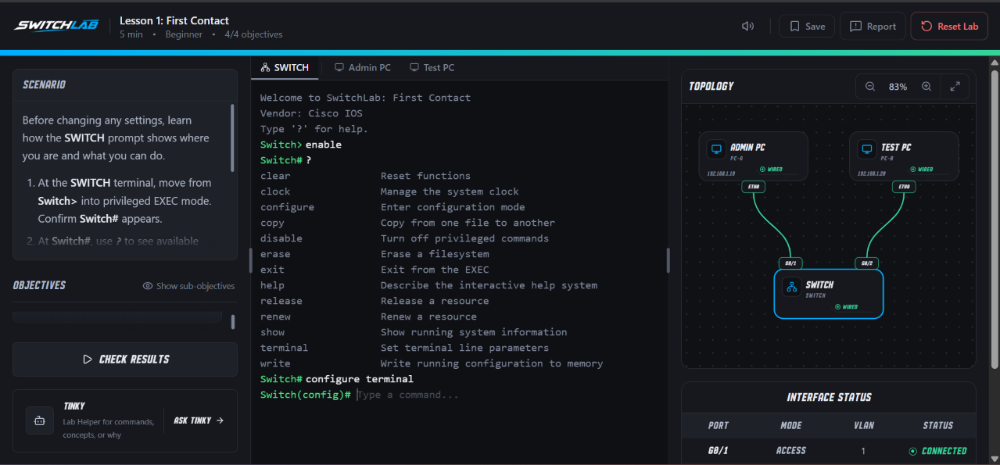

# Lesson 1 : First Contact

## Objectif
Comprendre la hiérarchie des modes de commande Cisco IOS (mode utilisateur vs mode privilégié vs mode de configuration globale) et utiliser l'aide contextuelle.

## Commandes apprises
* `enable` : Passe du mode EXEC utilisateur (`Switch>`) au mode EXEC privilégié (`Switch#`).
* `?` : Affiche la liste des commandes disponibles dans le mode actuel.
* `configure terminal` : Entre en mode de configuration globale (`Switch(config)#`).

## Capture d'écran
