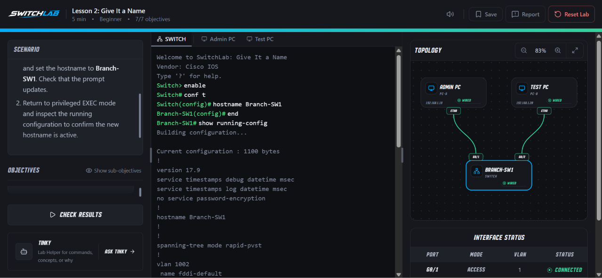

# Lesson 2 : Give It a Name

## Objectif
Attribuer un nom d'hôte personnalisé au commutateur et vérifier son application dans la configuration active.

## Commandes apprises
* `conf t` : Raccourci de `configure terminal`.
* `hostname Branch-SW1` : Définit le nom du commutateur sur `Branch-SW1`.
* `end` : Quitte directement le mode de configuration pour revenir au mode EXEC privilégié (`#`).
* `show running-config` : Affiche la configuration active en mémoire vive (RAM).

## Capture d'écran
