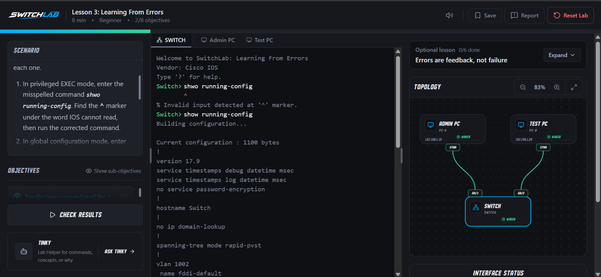
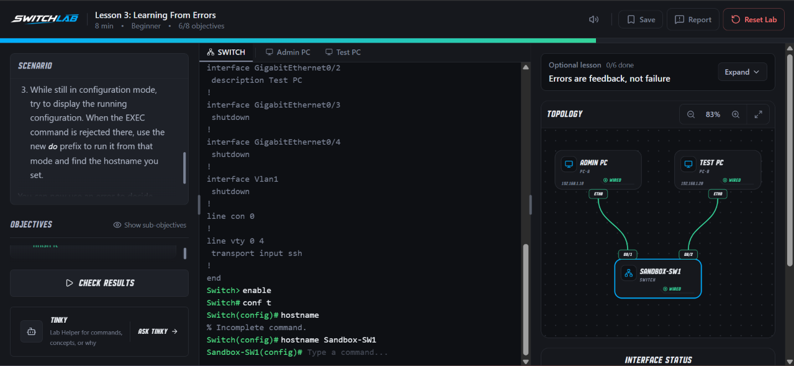
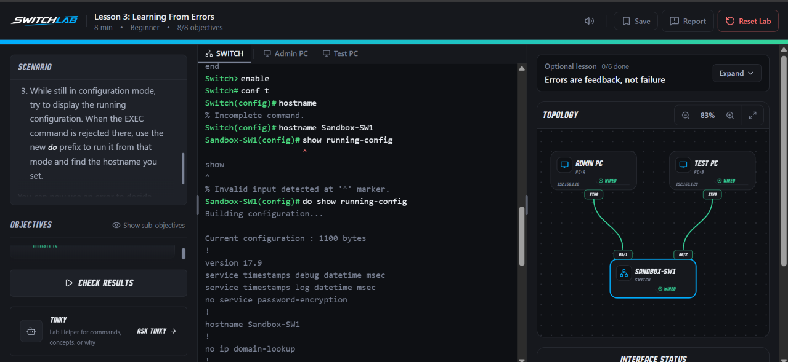

# Lesson 3 : Learning From Errors

## Objectif
Interpréter les messages d'erreur de Cisco IOS et exécuter des commandes d'affichage depuis le mode de configuration.

## Commandes et concepts appris
* **Marqueur `^`** : Indique l'endroit exact où IOS ne reconnaît pas une commande (ex. `shwo running-config` génère `% Invalid input detected at '^' marker`).
* **`% Incomplete command`** : Indique qu'un paramètre obligatoire manque à la commande (ex. `hostname` seul).
* `do <commande>` : Permet d'exécuter une commande du mode EXEC privilégié sans quitter le mode de configuration (ex. `do show running-config`).

## Captures d'écran

