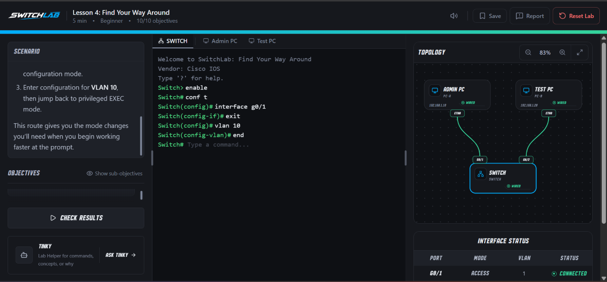

# Lesson 4 : Find Your Way Around

## Objectif
Naviguer efficacement entre les sous-modes de configuration (interfaces et VLANs).

## Commandes apprises
* `interface g0/1` : Accède au sous-mode de configuration de l'interface GigabitEthernet 0/1 (`Switch(config-if)#`).
* `exit` : Remonte d'un seul niveau hiérarchique (revient à `Switch(config)#`).
* `vlan 10` : Crée le VLAN 10 et entre dans son sous-mode de configuration (`Switch(config-vlan)#`).
* `end` : Sort de tous les sous-modes pour revenir directement à `Switch#`.

## Capture d'écran
